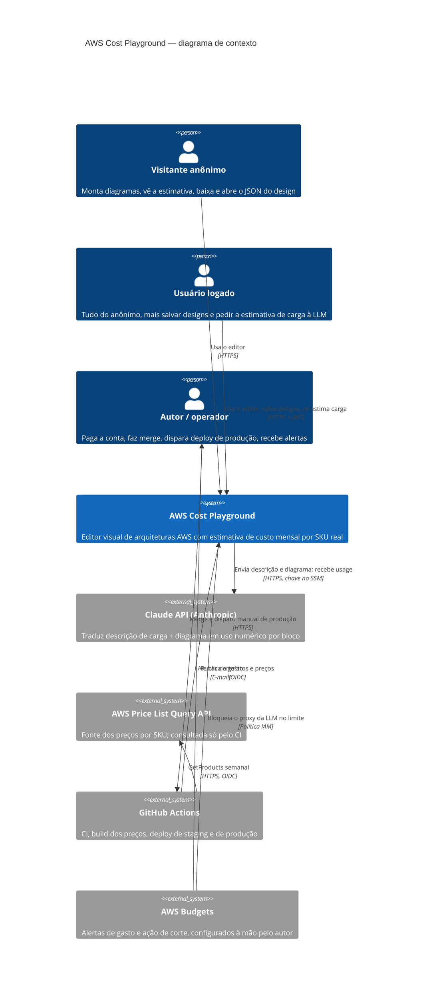

# C4 — Contexto: AWS Cost Playground

Nível 1 (contexto). Decisões em [ADR-0001](ADR-0001-stack.md).

## Fronteiras que importam

| Fronteira | O que cruza | Controle |
|---|---|---|
| Navegador → API | designs do usuário, pedido de estimativa | JWT do Cognito validado no API Gateway; identidade vem só do claim `sub` |
| API → Claude API | descrição de carga (texto livre) e diagrama | única fronteira que gasta dinheiro do autor; quotas, limite de tamanho, limite de gasto do workspace |
| CI → conta AWS | artefatos, Terraform, preços | OIDC com papel por ambiente; nenhuma chave estática |
| Arquivo JSON → navegador | design aberto por um anônimo | entrada não confiável; validada por schema antes de entrar no estado do editor |
